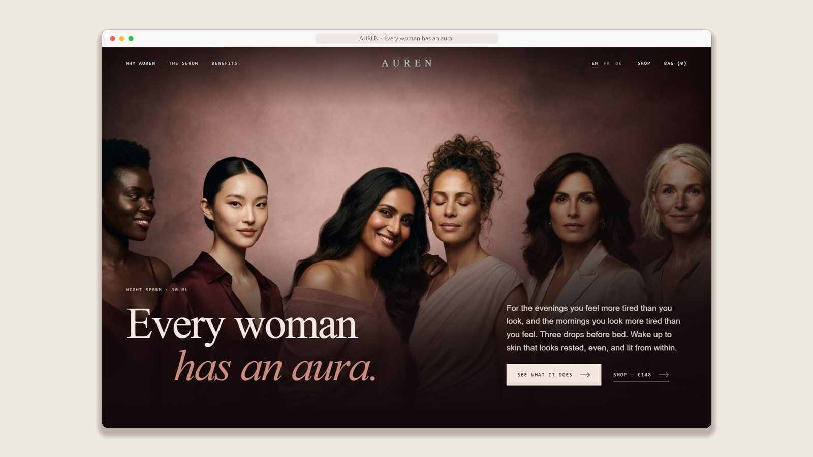
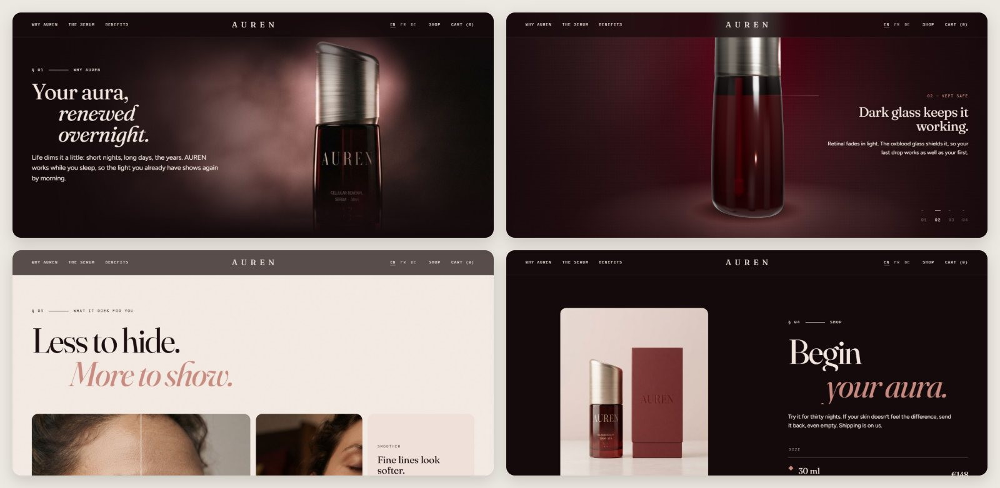

# AUREN — Landing Page

A premium skincare landing page built as a reusable template.

Built with **React 19, TypeScript, Vite and Three.js**.

## Preview

**Live: [auren-serum.vercel.app](https://auren-serum.vercel.app)**

[](https://auren-serum.vercel.app)

AUREN is a fictional skincare brand built around a simple idea: less information, stronger visuals and an immersive product experience.

## Inside the page



## Lighthouse

Measured with PageSpeed Insights on the live site.

| | Performance | Accessibility | Best practices | SEO |
|---|:---:|:---:|:---:|:---:|
| Mobile | 100 | 100 | 100 | 100 |
| Desktop | 100 | 100 | 100 | 100 |

## Getting started

```bash
npm install
npm run dev
```

Open http://localhost:5173.

| Command | Description |
|---|---|
| `npm run build` | Build for production |
| `npm run preview` | Preview the production build |
| `npm run typecheck` | Check TypeScript |

## Features

- Interactive 3D serum bottle built with Three.js.
- Scroll-driven animations and transitions.
- Responsive editorial layout.
- English, French and German.
- Before/after comparison slider.
- Configurable brand content and visual identity.

## Customize

Most of the customization happens in `src/content/`:

- `site.ts` — Brand name, content, images, colors and fonts.
- `i18n.ts` — French and German translations.
- `types.ts` — TypeScript configuration types.

Replace the images in `public/images/` and update the configuration to create your own brand.

## Project structure

```text
src/
  content/      # Brand configuration and translations
  sections/     # Landing page sections
  components/   # Reusable UI components
  hooks/        # Scroll and animation logic
  three/        # 3D bottle and Three.js scene
  styles/       # Global styles

public/images/  # Product and campaign images
```

## Notes

- The cart is a front-end demo, not connected to payments.
- Product images are AI-generated.
- Before/after visuals are illustrative, not real clinical results.

## License

MIT
