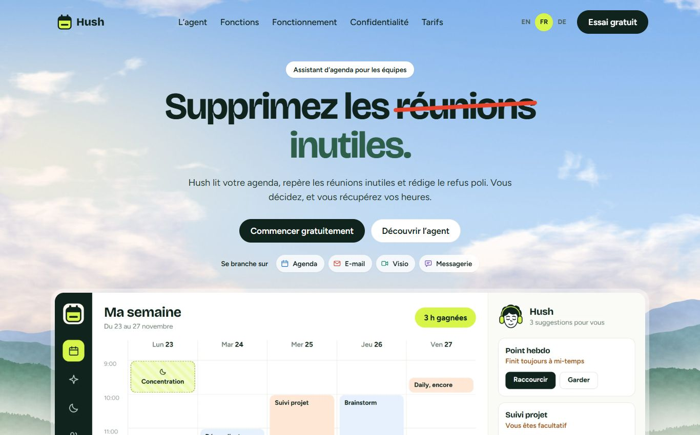

# Hush — Landing Page

A bright SaaS landing page for a product that does not exist: a calendar assistant that helps teams cut useless meetings.

Built with **React 19, TypeScript and Vite**. No animation or icon library.



## Getting started

```bash
npm install
npm run dev
```

Open http://localhost:5173.

| Command | Description |
|---|---|
| `npm run build` | Typecheck and build for production |
| `npm run preview` | Preview the production build |
| `npm test` | Check that every picture the page asks for exists (Node.js 22.6+) |

## Features

- A landscape hero with the menu inside it, turning into a floating pill on scroll, and a title whose "meetings" gets crossed out.
- Hush, the agent (see [AGENT.md](AGENT.md)), with its jobs arriving around it.
- Benefits, three animated illustrations for how it works, privacy cards, three moments of a quieter week, a testimonial and pricing.
- Everything appears on scroll. English, French and German.
- Keyboard friendly, and respects `prefers-reduced-motion`.

## Use your own pictures

Every screen, logo and photo is a plain file. Replace it, or change its path in `src/content/site.ts` (and `i18n.ts` for translated screens).

| Folder in `public/images/` | What | Size |
|---|---|---|
| `screens/app-<lang>.webp` | The app in the hero | 1920 × 1120 |
| `screens/skip-`, `reply-`, `focus-<lang>.webp` | The three feature pictures | 1024 × 864 |
| `screens/report-<lang>.webp` | What the manager sees | 800 × 600 |
| `logos/*.svg` | "Trusted by" logos | 160 × 32 |
| `steps/*.svg` | The three "how it works" illustrations (no text, animated) | 400 × 320 |
| `photos/focus.webp`, `lunch.webp`, `evening.webp` | Photos of people (prompts in [IMAGE_PROMPTS.md](IMAGE_PROMPTS.md)) | 2:1, 720 × 360 or larger |

Keep the `width`, `height` and `alt` in `site.ts` in step with your files.

The sample screens are drawn in `src/screens/`. To redraw one, run `npm run dev`, open `/screens.html?screen=app&lang=en` and capture the `#shot` element. That page is not part of the production build.

## Customize

- `src/content/site.ts`: every word, picture and price.
- `src/content/i18n.ts`: French and German.
- `src/styles/`: colours are CSS variables at the top of `base.css`.
- `src/sections/`: one file per section.

The hero sky (`public/images/sky-*.jpg`) was generated from noise functions in code for this project; it contains no third-party material. The company logos are invented for this project. The three photos are AI-generated (Google Gemini); the people in them do not exist.

Everything is fictional: the product, people, companies, prices and numbers. Fonts: Bricolage Grotesque and Figtree (Google Fonts, SIL Open Font License).
