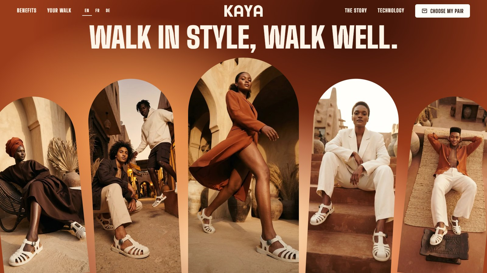
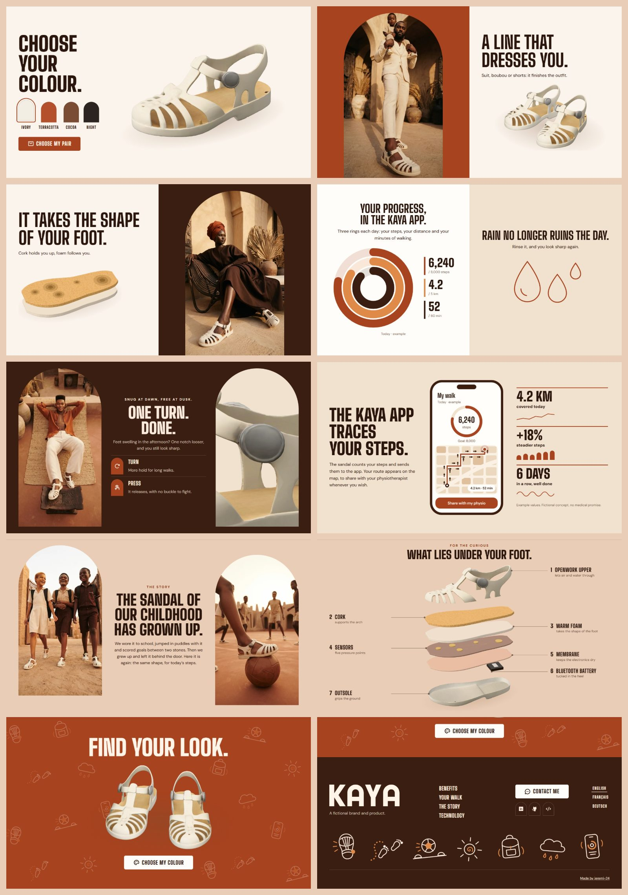

# Kaya — Landing Page

The plastic sandal of a West African childhood, grown up: a product landing page for a smart sandal that does not exist.

Built with **React 19, TypeScript, Vite and three.js**. No animation library and no icon package.

**Live: [kaya-lovat.vercel.app](https://kaya-lovat.vercel.app)**

[](https://kaya-lovat.vercel.app)

## Inside the page



## Getting started

```bash
npm install
npm run dev
```

Open http://localhost:5173.

| Command | Description |
|---|---|
| `npm run build` | Typecheck and build for production |
| `npm run preview` | Preview the production build |
| `npm test` | Check pictures and design tokens (Node.js 22.6+) |

## Features

- An opening with one headline and five photographs in arched frames on soft terracotta halos that wander at a steady pace (still for visitors who ask for less motion); on phones the frames are a strip to swipe.
- Straight after it, the sandal in 3D with its four colours. Drag it, or use the arrow keys, to turn it; the mouse wheel keeps scrolling the page.
- A pretend checkout in a window: size, way to pay and an invented price. It asks for no card or personal details, sends and stores nothing, and says so.
- Full-width bands where each life faces what the sandal brings to it, with drawings, the day's progress in three rings, the dial close up, the walk app (steps and route on a map) and the story. On wide screens each band holds on one screen.
- For the curious, the sandal opens into seven layers as the page scrolls.
- A wordmark whose two A's are arches, a bar that leaves while you read and returns when you scroll up, a full-screen menu on smaller screens.
- A footer with a contact button, icon links to the maker and a row of doodles, which also sit faintly behind the last band.
- Large previews of every picture. English, French and German. Keyboard friendly, and respects `prefers-reduced-motion`.
- three.js is downloaded only when a 3D view comes near; without WebGL the still pictures stay.

## Use your own pictures

Every picture is a plain file, named in `src/content/site.ts`. Replace the file, or change its path there.

| In `public/` | What | Size |
|---|---|---|
| `images/photos/hero.webp` | Middle photograph of the opening | 3:4, 896 × 1200 |
| `images/photos/street`, `boss.webp` | The arches beside it | 9:16, 640 × 1147 |
| `images/photos/maman`, `decontracte.webp` | The outer arches, then again further down | 9:16, 640 × 1147 |
| `images/photos/papa.webp` | The first benefit | 9:16, 640 × 1147 |
| `images/photos/ecole.webp`, `foot.webp` | The story | 2:3, 720 × 1073 |
| `images/art/hero.webp`, `layers.webp` | Still versions of the two 3D views | 1320 × 840, 1400 × 1240 |
| `images/art/pair.webp`, `bed.webp`, `dial-wide.webp` | Benefit drawings | see `site.ts` |
| `images/art/pair-ivory`, `-terracotta`, `-cocoa`, `-night.webp` | The four colours | 1200 × 640 |
| `images/art/walk-<lang>.webp` | The walk app (contains text, one per language) | 640 × 1180 |
| `images/brand/logo.svg`, `logo-light.svg` | Wordmark, for light and dark grounds | 326 × 100 |
| `images/charts/*.svg` | Progress rings, small charts and raindrops | |
| `images/doodles/*.png` | Doodles of the footer and the last band (list: `doodles` in `site.ts`) | 560 × 440, transparent |
| `models/kaya.glb` | The 3D sandal (rules in `src/three/model.ts`) | |
| `favicon.svg`, `og-image.jpg` | Tab icon, link preview (on Vercel its address is filled in at build time) | 1200 × 630 |

Keep the `width`, `height` and `alt` in `site.ts` in step with your files. How each of the five opening pictures is cropped is set in `src/styles/sections.css` (`object-position`). `npm test` checks that every named file exists.

The pictures in `images/art/` are drawn from the 3D file. After changing the model or the colours, run `npm run dev`, open `/renders.html?art=pair` (names in `src/renders/main.ts`) and save the canvas. That page is not part of the production build.

## Customize

- `src/content/site.ts`: every word and picture.
- `src/content/i18n.ts`: French and German.
- `src/styles/tokens.css`: colours, fonts and spacing, the [design system](DESIGN.md).
- `src/sections/`: one file per section. `src/three/`: the two live scenes.

## Where the pictures come from

- Photographs: AI-generated for this project from the prompts in [IMAGE_PROMPTS.md](IMAGE_PROMPTS.md). The people do not exist. A brand-like mark the generator drew on the football was retouched out.
- 3D sandal: generated with an AI tool for this project; stamp-like marks on its heel were retouched out of the texture. The inner layers shown in the exploded view are drawn in code from the outline of its sole.
- Charts, phone screens, drawings and doodles: made for this project.
- Icons: [Phosphor Icons](https://phosphoricons.com) 2.1.1 (MIT), copied into `src/components/Icon.tsx`.
- Fonts: Big Shoulders Display and DM Sans (Google Fonts, SIL Open Font License).

Visits are counted with Vercel Web Analytics when the page is deployed on Vercel with Analytics enabled; remove `<Analytics />` from `src/App.tsx` if you do not want it.

Everything is fictional: the brand, the product, its sensors and what they do, and every number. The page makes no medical claim.
